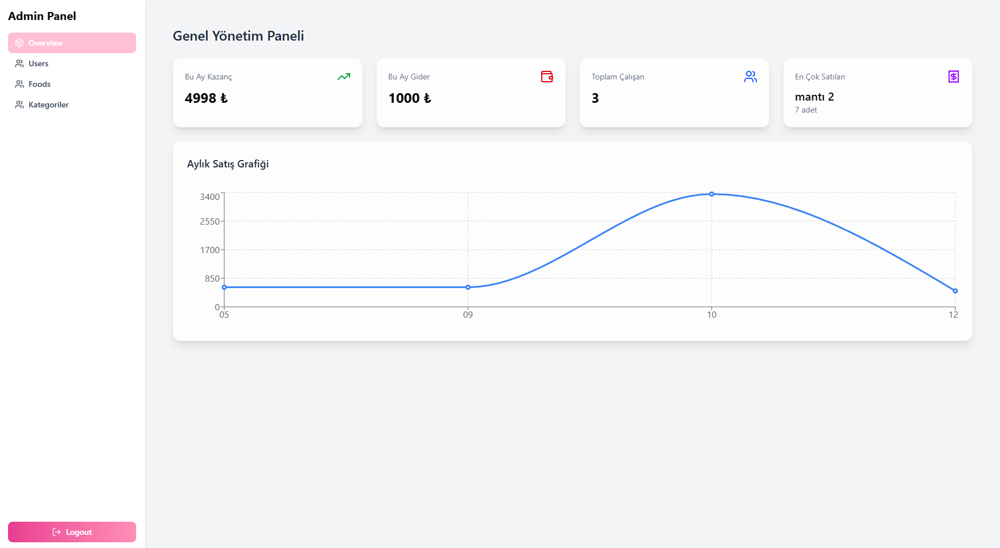
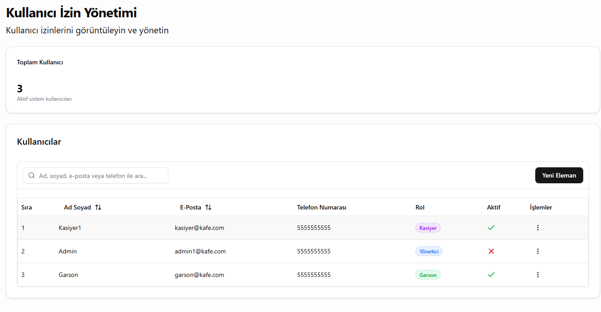
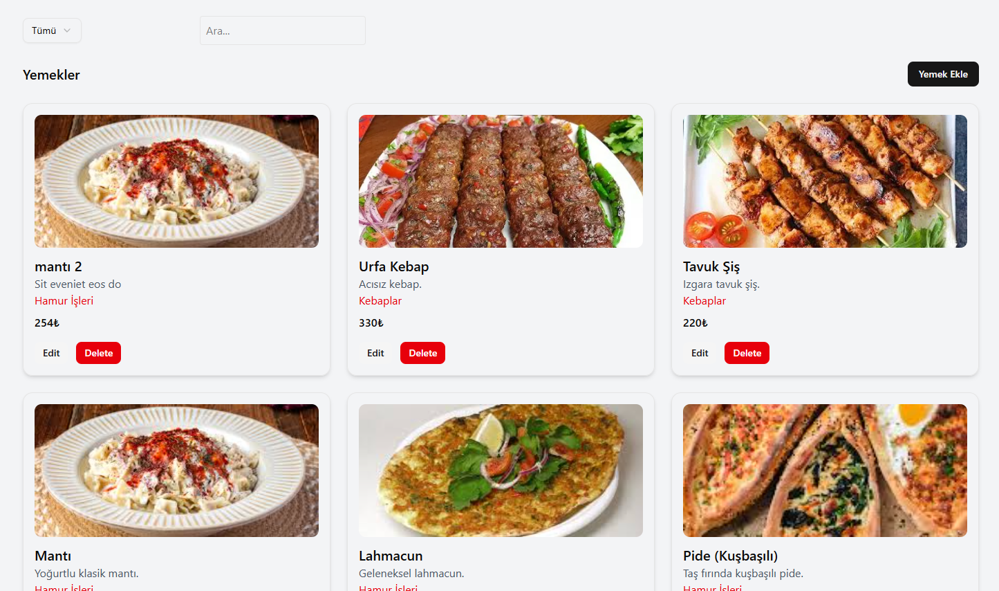
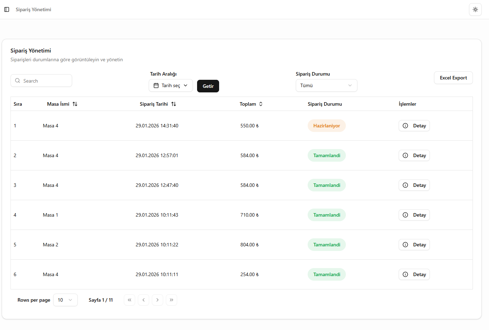
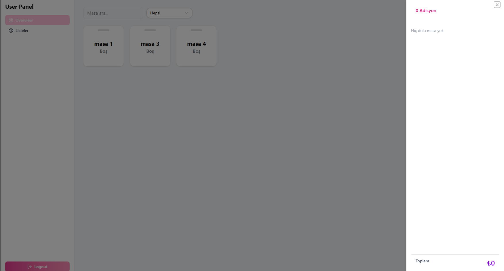
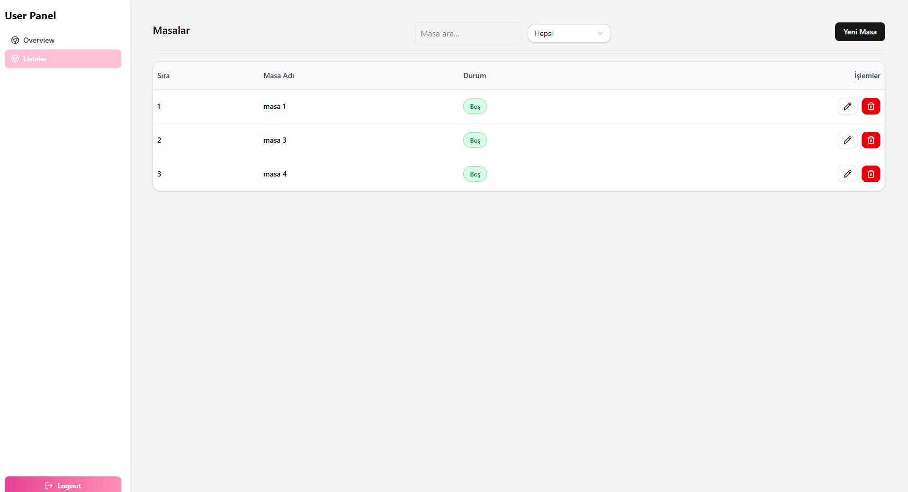

Harika! Projenin evrimini ve yeni teknolojilerini yansıtacak, profesyonel ve modern bir **README.md** hazırladım. State management'ın Redux'tan **Zustand**'a geçişi ve rol ayrımı (Garson vs Kasiyer) gibi detayları netleştirdim.

Aşağıdaki taslağı doğrudan kopyalayıp kullanabilirsin:

***

# 🍽️ Restoran Yönetim Sistemi (POS)

Modern, hızlı ve ölçeklenebilir bir restoran yönetim çözümü. Garsonların sipariş almasını, kasiyerlerin ödeme yönetmesini ve yöneticilerin işletme verilerini anlık olarak takip etmesini sağlar.

## 🚀 Teknolojiler

Bu proje, yüksek performans ve kullanıcı deneyimi odaklı modern bir stack ile geliştirilmiştir:

*   **Frontend:** Vite + React
    
*   **Backend:** Node.js + Express
    
*   **Veritabanı:** MongoDB (Mongoose ORM)
    
*   **State Management:** Zustand (Performanslı ve hafif state yönetimi)
    
*   **UI Bileşenleri:** Shadcn UI + Tailwind CSS (Theming desteği ile)
*   **Kimlik Doğrulama:** JWT tabanlı Auth yapısı
    

***

## 👥 Kullanıcı Rolleri ve Yetkiler

Sistem üç temel rol üzerine kurgulanmıştır:

| Yetki / Rol | Garson | Kasiyer | Yönetici (Admin) |
| --- | --- | --- | --- |
| Masaları Görüntüleme | ✅ | ✅ | ❌ |
| Sipariş Ekleme/Güncelleme | ✅ | ✅ | ❌ |
| Masa Değiştirme | ✅ | ✅ |❌ |
| **Ödeme Alma** | ❌ | ✅ | ❌|
| **İstatistikleri Görme** | ❌ | ❌ | ✅ |
| **CRUD (Yemek, Kategori, Kullanıcı)** | ❌ | ❌ | ✅ |


***

## ✨ Temel Özellikler

### 🤵 Garson & Kasiyer Paneli

*   **Masa Yönetimi:** Masaların doluluk oranını anlık görün, masa değiştirme işlemlerini saniyeler içinde yapın.
    
*   **Sepet İşlemleri:** Yemek ekleme, çıkarma, sipariş onaylama ve silme.
    
*   **Ödeme Sistemi:** Kasiyerler için entegre ödeme alma arayüzü.
    

### 👑 Yönetici Paneli

*   **Gelişmiş CRUD:** Yemek ve kategori yönetimi.
    
    *   _Kategori Silme Mantığı:_ Bir kategori silinirken içindeki yemekler için yeni bir kategori atanması istenir veya toplu silme onayı alınır.
        
*   **Personel Onay Sistemi:** Yeni kayıt olan çalışanlar, yönetici onaylamadan sisteme giriş yapamaz.
    
*   **Finansal Takip:** Aylık gelir istatistikleri ve günlük sipariş özetleri.
    

***

## 📸 Ekran Görüntüleri

<p float="left">   </p>

<p float="left">   </p>

<p float="left">   </p>

***

## ⚙️ Kurulum ve Yapılandırma

1.  Projeyi klonlayın.
    
2.  Gerekli bağımlılıkları yükleyin: `npm install`
    
3.  `.env` dosyanızı oluşturun (Örnek yapı `index.js` içerisinde belirtilmiştir):
    
    Kod snippet'i
    
    ```
    PORT=5000
    MONGO_URI=your_mongodb_uri
    JWT_SECRET=your_secret_key
    ```
    
4.  Uygulamayı başlatın: `npm run dev`
    

***

## 📝 Gelecek Planları (Roadmap)

Projenin geliştirilmeye açık yönleri ve planlanan güncellemeler için `yapilacaklar.txt` dosyasını inceleyebilirsiniz. Satış süreci ve özel düzenleme talepleri için iletişim bilgilerim sistemde mevcuttur.

***

**İstersen `yapilacaklar.txt` içeriğinden birkaç maddeyi "Gelecek Özellikler" kısmına madde madde ekleyebilirim, ne dersin?**