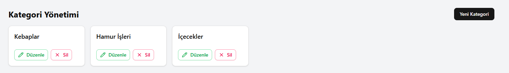

bu projede nodejs + vite kullanıldı 
auth işlemleri icin redux +persist kullanıldı 
admin kullanıcısı gerecek hayatta yonetisi restoran sahibi 
user ise garson ve kasiyor gorevinde 
tasarım olarak shadnc uı kullanıldı daha cok 
back de veritabanı olarak mongoose  kullanıldı 

proje acıklaması 
garson yada kasiyer sisteme girer
karsisina masalar cıkar tıklar ve yemekler ekler cıkartır 
sepeti onaylar, siler ,masa degistirebilir ve  odeme alır 
ve masa ekleme silme ve guncelleme yapar

admin ise 
yemek ekle edit delete yapar
ve kategory ekle edit delete yapar delete yaprken altında yemekler varsa kullanıcıdan yeni kategor vermesi beklenir yada ona ait tum yemekler de silinir 
işletmenin gelirini gorur 
aktif calisanları gorur yeni birisi katilirsa adminin oncelikle izin vermesi beklenir 

bu proje daah geliştirilebilir bunları ayrıca yapilacaklar.txt de belirttim 
satısı yapılırken nasıl yapılacagı duzenleme istenirse nasıl olacagı hakkında bilgiler mevcut 

  
  

  
  

  
  

